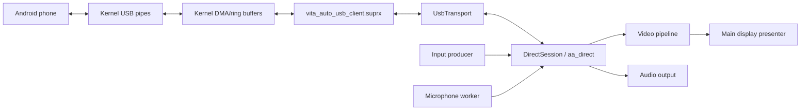

# Architecture

Vita Auto is a Vita app, a user-mode bridge and a kernel plugin. The app owns the
session and presentation and runs one protocol at a time: Android Auto (USB or
wireless) or, with `carplay=on`, wireless Apple CarPlay. The kernel plugin owns USB
host mode, Android Open Accessory setup, bulk pipes, the Bluetooth stack (Android
Auto's bootstrap and CarPlay's iAP2 link) and the Wi-Fi access point.

## Source layout

| Folder | Responsibility |
| --- | --- |
| `src/app` | Lifecycle, connection screens, retry/exit policy (`recovery.h`), settings |
| `src/android_auto` | Android Auto framing, service discovery, TLS, channels |
| `src/carplay` | Wireless CarPlay: iAP2 endpoint, AirPlay control, session, Bonjour ([carplay.md](carplay.md)) |
| `src/audio` | PCM/AAC playback and microphone capture |
| `src/inputs` | Vita buttons, touch, input event queue |
| `src/video` | H.264 parsing/decoding, frame ordering, presentation |
| `src/transport` | `Transport` interface: USB, Wi-Fi (TCP), Auto (waits on all); also the Bluetooth stack (`bt_stack`), Android Auto's Bluetooth bootstrap, the Wi-Fi AP and the shared wireless settings (`wireless_config.h`) |
| `src/logger`, `src/common` | Logging, shared utilities |
| `kernel` | Kernel plugin (`.inc` files share one translation unit), user-mode bridge, exports, loader |

## Shared by Android Auto and CarPlay

| Piece | Where |
| --- | --- |
| Video: H.264 queue, decoder, presentation (`video::pipeline::Frame` is the protocol-neutral input) | `src/video` |
| Audio playback | `src/audio/audio_output.*` |
| Touch, buttons, input queue and latency mark | `src/inputs`, `src/video/input_mark.h` |
| Decoder-failure and start-timeout checks | `src/app/session_watch.h` |
| Bluetooth bring-up, name handling, stream claim, event log | `src/transport/bt_stack.*` |
| Wireless settings (Bluetooth name, Wi-Fi network, access point) | `src/transport/wireless_config.h` |
| The Vita's Wi-Fi access point | `src/transport/wifi_ap.*`, `kernel/vita_auto_ap.inc` |
| Status and connection screens | `src/video/status_screen.*`, `src/app/connection_screen.*` |

`direct_session.cpp` chooses the protocol: CarPlay runs `carplay::run()`
([carplay.md](carplay.md)), otherwise the Android Auto loop below.

## Pieces

- `vita_auto.vpk` is the app. It bundles `vita_auto_usb_client.suprx`, loaded from
  `app0:`.
- `vita_auto_usb.skprx` is the taiHEN kernel plugin.
- `vita_auto_usb_client.suprx` imports the plugin's syscalls and exports app-callable
  functions (`vitaAutoUsbStart`, `vitaAutoUsbWrite`, `vitaAutoUsbReadWaitTimed`, ...).
  The VPK and plugin must come from the same release.

## Runtime tasks

| Task | Files | Owns |
| --- | --- | --- |
| Main thread | `main.cpp`, `app/application.cpp` | Lifecycle, screens, retry/exit, final video presentation |
| Session thread | `app/direct_session.cpp`, `android_auto/aa_direct*.cpp`, `transport/*`; for CarPlay `carplay/*` | Transport, AA framing, TLS, channels, audio outputs, microphone coordination; CarPlay's Bluetooth, AirPlay sockets and projection |
| Input producer | `inputs/*` | Buttons, sticks, touch; only enqueues events |
| Microphone worker | `audio/microphone_input.cpp` | Capture into a frame queue |
| Video decoder worker | `video/video_pipeline.cpp` | Ordered compressed queue, H.264 decoder, latest frame |
| Audio playback | `audio/audio_output.cpp`, `audio_sink.cpp` | Media/guidance/system PCM ports |
| Kernel callbacks | `kernel/vita_auto_usb_bulk.inc`, `..._session.inc` | Attach/detach, transfer completion, pipe state |
| Kernel syscalls | `kernel/vita_auto_usb_syscalls.inc`, `kernel/client/` | Start/stop/read/write/wake entry points |

USB reads complete in kernel callbacks into ring storage and wake user mode; the
app reads through `UsbTransport` and routes channel payloads. Input and microphone
producers only enqueue: the session decides when to flush so channel ordering stays
controlled.

## Startup

1. `main.cpp` resets logging and calls the app runner.
2. `application.cpp` takes the HOME/automatic-USB shell locks (`usb_shell_lock.cpp`)
   and initialises input and display.
3. `direct_session.cpp` starts the session; `usb_transport.cpp` loads the bridge and
   the kernel plugin negotiates accessory mode and the AA version handshake.
4. `aa_direct.cpp` starts TLS and service setup; video, audio, microphone and input
   begin when the phone opens the channels.

Wi-Fi has no kernel step, so `DirectSession::start()` sends VERSION_REQUEST itself.

## Disconnect and recovery

1. Stop accepting input, then stop producers before USB cleanup.
2. Close the USB session and let transfer callbacks drain.
3. Hand off display resources before GXM/libvita2d are freed.
4. Recoverable outcomes schedule another attempt (`recovery.h` decides automatic
   retry, manual retry or restart; `application.cpp` applies it, the connection
   screen only displays it).

If USB or display cleanup cannot complete, the app asks for a restart and refuses a
new attempt rather than reuse state whose ownership is unclear. A physical unplug
can strand USB requests without callbacks; that also needs a reboot.

HOME stays locked until USB, input, video and display cleanup succeed, including
between automatic retries (this follows VitaShell's `sceShellUtilLock`).
**Start + Select** requests a manual disconnect and stops retries; **Cross** takes
the locks again. For a user disconnect the IO owner calls `vitaAutoUsbDrainReads()`,
keeps answering AA pings while it consumes the remaining packets, then sends the
shutdown request; a timeout retains buffers and blocks a new session. The first
error and its detail are kept until reset, and a cleanup failure never replaces it.

## Build, CI, patch

`VITA_AUTO_VERBOSE_LOGGING` adds startup/runtime logs and the raw Bluetooth, AirPlay
and mDNS dumps, and `VITA_AUTO_PERFORMANCE` adds counters; outcomes and errors are
always logged. GitHub Actions builds a quiet
flavor (both off) and a diagnostic flavor (both on), and tagged releases package
both with checksums. Mbed TLS is a submodule; `cmake/ApplyMbedTlsPatch.cmake`
applies `patches/mbedtls-x509-legacy-timezone.patch` so the head-unit certificate's
legacy timezone suffix loads without changing the DER bytes.
