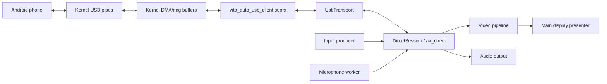

# Core Tasks and Low-Level Architecture

This page explains the some of the moving parts that are alive while Vita Auto is running.
It is written for people who just a faster way to get up to speed.

## Runtime Task Map

| Task or context | Main files | Owns | Talks to |
| --- | --- | --- | --- |
| Main app thread | `src/main.cpp`, `src/app/application.cpp` | App lifecycle, connection screens, retry/exit flow, final video presentation | Direct session, input manager, video pipeline |
| Direct USB session thread | `src/app/direct_session.cpp`, `src/android_auto/aa_direct.cpp`, `src/transport/usb_transport.cpp` | USB transport, Android Auto framing, TLS, channel state, audio outputs, microphone coordination | Kernel USB bridge, input queue, microphone queue, video pipeline |
| Input producer | `src/inputs/vita_input.cpp`, `src/inputs/vita_controller_input.cpp`, `src/inputs/vita_touch_input.cpp`, `src/inputs/input_event_queue.h` | Vita buttons, sticks, touch events, input queue writes | Direct USB session through queued events and USB wakeups |
| Microphone capture worker | `src/audio/microphone_input.cpp` | Audio input port, PCM capture, microphone frame queue | Direct USB session through queued microphone frames and USB wakeups |
| Video decoder worker | `src/video/video_pipeline.cpp` | Ordered compressed video queue, H.264 decoder, latest decoded frame | Direct USB session writes compressed frames: main thread presents decoded frames |
| Audio playback | `src/audio/audio_output.cpp`, `src/audio/audio_sink.cpp` | Media/guidance/system PCM output ports | Direct USB session routes Android Auto audio channel data |
| Kernel USB callbacks | `kernel/vita_auto_usb_bulk.inc`, `kernel/vita_auto_usb_session.inc` | Device attach/detach, transfer completion, pipe state, callback-side diagnostics | Kernel transfer scheduler and syscall context |
| Kernel syscall context | `kernel/vita_auto_usb_syscalls.inc`, `kernel/client/vita_auto_usb_client.c` | Start/stop/read/write/wake/diagnostic entry points used by the app | App-side USB transport and kernel USB state |

The kernel `.inc` files are included by `kernel/vita_auto_usb_kernel.c`, so they
share its private state within one C translation unit. Android Auto receive and
channel handling live in `aa_direct.cpp`: media handling, outgoing input/microphone
messages, and message encoding helpers live in `aa_direct_media.cpp`,
`aa_direct_output.cpp`, and `aa_direct_messages.cpp` alongside it.

## Low-Level Data Flow

Inbound USB data enters the kernel plugin through USB transfer callbacks. The
kernel stores completed reads in its ring storage, then wakes user mode. The app
reads packets through `UsbTransport`, feeds Android Auto framing/TLS/session
logic, and routes channel payloads to video, audio, or control handling.

Outbound data is built by the direct session and written through `UsbTransport`.
Input and microphone producers only enqueue data: the direct session decides when
to flush those queues so Android Auto channel ordering stays controlled.

## Failure and Recovery

The kernel completes version negotiation before `DirectSession::startAfterVersion()`
starts TLS. A failed AA session retains its first error and TLS detail until reset:
later input cannot resume the failed session.

The IO owner preserves the first app error and its SDK/protocol detail. USB close
returns its own stop result separately, so a cleanup failure cannot replace or
mislabel the original error. Cleanup failures are still logged and prevent reuse
when cleanup has not completed.

For a user-requested disconnect, the IO owner first calls `vitaAutoUsbDrainReads()`
to stop bulk reads. It sends AA pings while consuming the remaining packets,
then sends the shutdown request. A timeout retains buffers and prevents a new session.

A physical unplug may strand USB-driver requests without callbacks,
that case still requires a reboot.

`src/app/recovery.h` defines which session outcomes allow automatic retry, manual
retry, or require a restart. `application.cpp` applies that policy and honours
disconnect/exit requests: `connection_screen.cpp` only displays the outcome.
