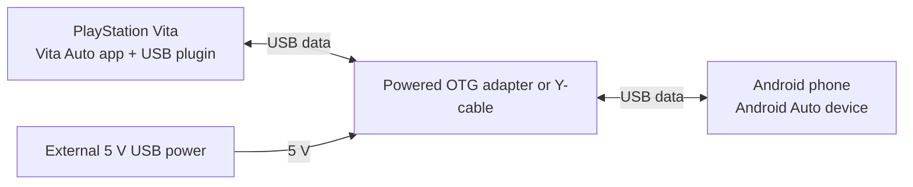

# Setup and Install

This guide is for installing release builds on a Vita and connecting a phone.
For source layout and maintainer notes, read [architecture.md](architecture.md).

## What You Need

- A hacked PlayStation Vita with taiHEN.
- A phone with Android Auto.
- A USB cable.
- A USB OTG/power arrangement that makes the phone see a stable 5 V USB host.
- The Vita Auto release zip.

Android phones expect VBUS power before they behave
like a USB device. The Vita does not expose a powered USB-A host port, so
most setups need an OTG adapter or Y-cable that supplies 5 V externally while
still connecting data between the Vita and the phone. This will also charge the vita.

## OTG / Power Diagram

The goal is data between the Vita and phone, plus a stable external 5 V supply
on the phone's USB VBUS side.



## Release Files

A release zip contains:

| File | Install manually? | Purpose |
| --- | --- | --- |
| `vita_auto.vpk` | Yes | Installs the Vita app |
| `vita_auto_usb.skprx` | Yes | Kernel USB plugin loaded by taiHEN |
| `vita_auto_usb_client.suprx` | No | User-mode bridge, the VPK also bundles this as `app0:vita_auto_usb_client.suprx` |

Do not rename the files inside the release zip. The app loads the client bridge
from `app0:vita_auto_usb_client.suprx`.

## Install Steps

1. Install `vita_auto.vpk` with VitaShell or your preferred VPK installer.
2. Copy `vita_auto_usb.skprx` to a taiHEN plugin location, for example:

   ```text
   ur0:tai/vita_auto_usb.skprx
   ```

3. Add the kernel plugin under `*KERNEL` in `ur0:tai/config.txt`:

   ```text
   *KERNEL
   ur0:tai/vita_auto_usb.skprx
   ```

4. Reboot the Vita.
5. Open Vita Auto.
6. Connect the phone through your powered OTG setup.
7. Unlock the phone and accept any Android Auto prompts.

## Controls

- **Cross** retries immediately from an error/retry screen.
- **Circle** exits from a connection/error screen, including while waiting for USB.
- **Start + Select** disconnects, including during streaming or while waiting for a phone.
- On **Disconnected**, **Cross** reconnects and **Circle** exits.
- **Triangle** changes **Music + Nav: Vita / Phone** while disconnected or on a retry/error
  screen. Press **Cross** to connect with that choice. Changing it pauses automatic retries.

To change audio during a session, press **Start + Select**, wait for **Disconnected**,
then press **Triangle** and **Cross**. Music and navigation follow the same setting.
**Vita** is the default. **Phone** leaves their routing to Android, including its
selected Bluetooth output. System sounds still use the Vita, and its microphone
remains available in either mode.

The audio choice is saved in `ux0:data/vita_auto/vita_auto_audio.txt`.
The app creates this folder automatically and imports an existing audio setting
from the old location.

HOME is blocked while the app owns USB, including between automatic retries.
To open LiveArea, press **Start + Select** and wait for **Disconnected** before
pressing HOME. Reopening the app leaves it disconnected until you press **Cross**.
If cleanup fails, the app shows **Restart required** and keeps HOME locked.

## Logs and Errors

The app writes logs to:

```text
ux0:data/vita_auto/vita_auto.log
```

The error screen shows a numeric code and label. For bug reports, include both
the screen error and the log file when possible.

Use the quiet release first. Use the diagnostic release when you need extra logs
for USB, Android Auto protocol, audio, video, or reconnect failures.

## Troubleshooting

If the app stays on the waiting screen:

- Check that `vita_auto_usb.skprx` is under `*KERNEL`.
- Reboot after editing tai config.
- Confirm the phone is connected through a data cable.
- Confirm the OTG adapter or Y-cable supplies 5 V to the phone side.
- Unlock the phone and look for Android Auto prompts.

If the app reports a cleanup/restart error:

- Reboot the Vita before trying another session.
- If it repeats, look in `ux0:data/vita_auto/vita_auto.log`.
