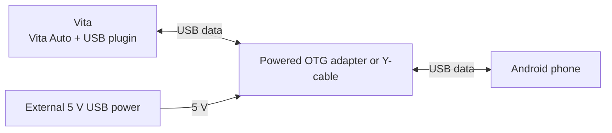

# Setup and Install

For wireless see [wireless.md](wireless.md), for CarPlay [carplay.md](carplay.md),
for the code [architecture.md](architecture.md).

## What you need

- A hacked Vita with taiHEN, and either an Android phone with Android Auto or, for the
  experimental CarPlay mode, an iPhone ([carplay.md](carplay.md)).
- A USB data cable and an OTG/power arrangement that makes the phone see a stable
  5 V host. The Vita has no powered USB-A host port, so use a powered OTG adapter
  or Y-cable (it also charges the Vita).



## Install

The release zip holds three files; do not rename them.

| File | Install manually? | Purpose |
| --- | --- | --- |
| `vita_auto.vpk` | Yes | The app (also bundles the bridge as `app0:vita_auto_usb_client.suprx`) |
| `vita_auto_usb.skprx` | Yes | Kernel plugin loaded by taiHEN |
| `vita_auto_usb_client.suprx` | No | User-mode bridge, loaded from inside the VPK |

1. Install `vita_auto.vpk`. It is an unsafe app: turn on **Enable Unsafe Homebrew**
   in Settings > HENkaku Settings first.
2. Copy `vita_auto_usb.skprx` to `ur0:tai/` and add it under `*KERNEL` in
   `ur0:tai/config.txt`:

   ```text
   *KERNEL
   ur0:tai/vita_auto_usb.skprx
   ```

3. Reboot, open Vita Auto, connect the phone through the powered OTG setup, unlock
   it and accept any Android Auto prompts.

## Android Auto or CarPlay

The app runs one at a time, chosen by `carplay` in the settings file (below). With
`carplay=off` (the default) it runs Android Auto over USB or wirelessly. With
`carplay=on` it runs wireless CarPlay only: USB, the Headunit Server and the Android
Auto Bluetooth bootstrap are not started, so an Android phone cannot connect. Press
**Square** on the connection screen to switch (it is saved), or edit the setting and
reopen the app. The USB plugin must be installed either way
(CarPlay's Bluetooth and Wi-Fi access point live in it).

## Controls

The connection screen shows the state (Waiting for phone, Connecting, ...) and two
settings as rows of choices with the active one in brackets: **Mode** (Auto, USB,
Wi-Fi, CarPlay) and **Music + Nav** (Vita, Phone; Android Auto only). The button for
changing each is shown beside it.

- **Cross** retries; on **Disconnected** it reconnects.
- **Circle** exits from a connection/error screen or **Disconnected**.
- **Start + Select** disconnects, including while streaming or waiting.
- **Square** cycles the connection: Auto (USB, Wi-Fi or Bluetooth, first to appear),
  USB only, Wi-Fi only (Headunit Server and Bluetooth), Apple CarPlay (wireless).
- **Triangle** toggles **Music + Nav: Vita / Phone** while disconnected or on a
  retry screen (it pauses automatic retries; press **Cross** to connect). To change
  it mid-session: Start + Select, wait for **Disconnected**, Triangle, Cross.
  **Phone** leaves music and navigation to Android's own routing; system sounds and
  the microphone stay on the Vita.

HOME is blocked while the app owns USB, including between retries: press
**Start + Select** and wait for **Disconnected** first. If cleanup fails the app
shows **Restart required** and keeps HOME locked.

## Settings

`ux0:data/vita_auto/vita_auto_settings.txt` holds every option, written by the app
with a description of each at the top (lines without `=` are comments):

```
audio=vita              vita | phone
connection=auto         auto | usb | wifi
host=                   Headunit Server address (wireless.md)
bluetooth=on            Bluetooth bootstrap (wireless.md)
bluetooth_name=Vita Auto
wifi_password=          network the phone is told to join (wireless.md)
wifi_ap=off             Vita hosts the Wi-Fi network (wireless.md)
wifi_ap_ssid=Vita Auto
wifi_ap_password=vitaauto
wifi_ap_channel=6
carplay=off             on = Apple CarPlay instead of Android Auto (carplay.md)
original_device_name=   managed by the app; leave it alone
```

## Logs, errors, troubleshooting

The log is `ux0:data/vita_auto/vita_auto.log`. The error screen shows a numeric code
and label; include both in bug reports. Use the quiet release normally and the
diagnostic release when you need extra USB, protocol, audio, video or reconnect logs
(it also writes the raw Bluetooth event, AirPlay and mDNS dumps; the quiet one keeps
only outcomes and errors).

`bt: the kernel plugin is not the build this app was made with` means the app and
`vita_auto_usb.skprx` come from different builds: install all three files together
and reboot the Vita.

If the app stays on the waiting screen (Android Auto): check `vita_auto_usb.skprx` is under
`*KERNEL` and the Vita was rebooted, the cable carries data, the adapter supplies
5 V to the phone side, and the phone is unlocked. After a cleanup/restart error,
reboot the Vita and check the log if it repeats.
